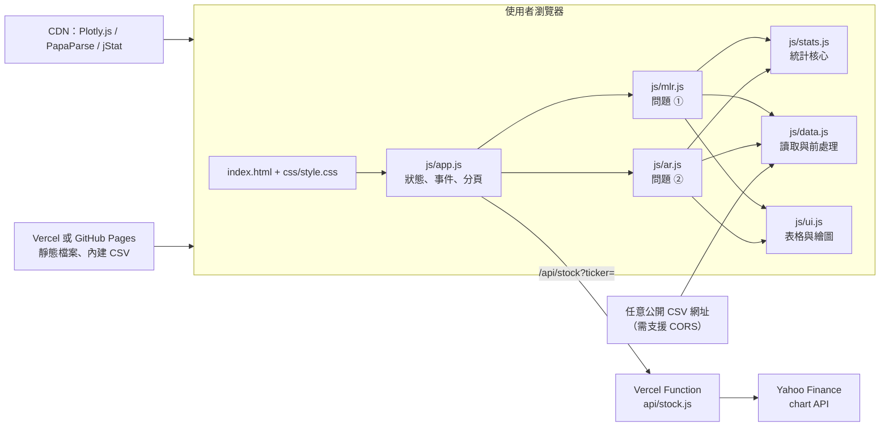
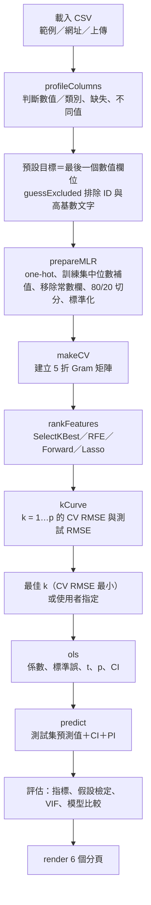
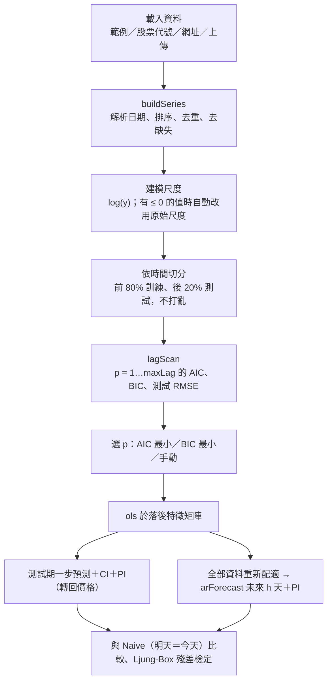

# design.md — HW2 線性回歸預測平台 設計文件

物聯網應用與資料分析（7716）｜游雅婷｜5115056031

- 線上版：https://aiot-hw2-regression.vercel.app （GitHub Pages：https://jua91352.github.io/AIoT-HW2-Regression/ ）
- 原始碼：https://github.com/jua91352/AIoT-HW2-Regression

---

## 1. 目標與範圍

做一個可以直接部署、任何人打開網址就能操作的線性回歸預測平台，依 CRISP-DM 流程完成 HW2 的分析要求，並滿足兩個加分項。

| 需求來源 | 需求 | 設計對應 |
|---|---|---|
| 加分 +1 | 有下拉視窗呈現兩種 problem | 頁首 `#problem` 下拉選單：① 多元線性回歸（表格資料）② Auto Regression（股價時間序列） |
| 加分 +2 | 可任意輸入 Dataset | 側邊欄「資料來源」：範例／CSV 網址／上傳檔案；問題 ② 另有股票代號 |
| 作業 2-1 | Kaggle 資料集、特徵 > 13、標示來源 | 預設 Kaggle Predict the Flood（20 個特徵），來源連結顯示在「商業理解」分頁與 README |
| 作業 2-2 | 線性回歸、特徵選擇、模型評估、預測圖＋信賴／預測區間 | 4 種特徵選擇＋CV 選 k；MAE／MSE／RMSE／R²／Adj. R²；CI 與 PI 色帶預測圖 |
| 作業 2-3 | CRISP-DM 六步驟 | 主畫面固定 6 個分頁，一個分頁對應一個步驟 |
| 繳交 | GitHub + web | 靜態網站部署於 Vercel 與 GitHub Pages |

**不在範圍內**：非線性模型（樹模型、神經網路）、使用者帳號、伺服器端儲存資料。

## 2. 使用者與使用情境

| 使用者 | 情境 |
|---|---|
| 老師／助教 | 打開網址 → 下拉切換兩種問題 → 貼上自己的 CSV 網址（例如 50_Startups）→ 逐頁檢查 CRISP-DM 內容 |
| 學生本人 | 換資料集、換特徵選擇方法、調整 k 與信賴水準，觀察結果變化，作為報告素材 |
| 一般使用者 | 輸入股票代號看 AR 預測與預測區間；在「部署」分頁輸入新資料取得預測值 |

## 3. 系統架構

採用**純前端**架構：所有資料處理與統計計算都在瀏覽器裡以 JavaScript 執行，伺服器只負責提供靜態檔案。唯一的後端是 Vercel 上一支股價代理函式。



**為什麼不用 Streamlit／Python 後端**

| 考量 | 純前端 | Streamlit |
|---|---|---|
| 部署 | GitHub Pages、Vercel 免費、免維護 | 需要能執行 Python 的主機 |
| 回應速度 | 不經網路往返，調整參數即時重算 | 每次互動都要伺服器重跑 |
| 使用者資料 | 上傳的 CSV 只在瀏覽器處理 | 檔案會傳到伺服器 |
| 代價 | 統計方法要自己實作並驗證 | 可直接用 statsmodels / scikit-learn |

代價用「與 statsmodels 逐項對照」來控制（見第 11 節）。

## 4. 模組設計

| 檔案 | 職責 | 主要函式 |
|---|---|---|
| `js/app.js` | 問題切換、資料來源載入、側邊欄設定、分頁切換、錯誤顯示 | `loadMLR`、`loadAR`、`fetchStock`、`compute`、`render`、`switchProblem` |
| `js/data.js` | CSV 下載與解析、欄位型態判斷、預設排除欄位、one-hot、補值、切分、時間序列整理 | `fetchCsv`、`parseCsvBuffer`、`profileColumns`、`guessExcluded`、`prepareMLR`、`buildSeries`、`parseDate` |
| `js/stats.js` | 線性代數、OLS、CI/PI、K-fold CV、特徵選擇、Lasso、Ridge、假設檢定、ACF/PACF、AR 預測 | `ols`、`makeCV`、`cvScore`、`forwardOrder`、`rfeOrder`、`lassoCV`、`ridgeCV`、`lagScan`、`arForecast` |
| `js/mlr.js` | 問題 ① 的計算流程與 6 個分頁畫面 | `runMLR`、`renderMLR`、`mlrKpis` |
| `js/ar.js` | 問題 ② 的計算流程與 6 個分頁畫面 | `runAR`、`renderAR`、`arKpis` |
| `js/ui.js` | 數字格式化、表格、卡片、下載、Plotly 主題 | `fmt`、`table`、`card`、`plot`、`band` |
| `js/config.js` | 部署設定 | `REMOTE_STOCK_API`、`REPO_URL` |
| `api/stock.js` | Vercel Serverless Function：抓 Yahoo 日線並轉成 CSV、加上 CORS 標頭 | `fetchStockCsv` |
| `scripts/dev-server.js` | 本機開發伺服器（靜態檔案＋模擬 `/api/stock`） | — |

設計原則：**計算與畫面分離**。`run*` 只回傳結果物件，`render*` 只負責把結果畫出來；切換分頁只重畫、不重算。

## 5. 資料流程

### 問題 ① 多元線性回歸



快取設計：資料、目標、排除欄位、測試比例不變時，重用準備好的資料與 Gram 矩陣；換特徵選擇方法才重算排序；換 k 或信賴水準只重算 OLS（毫秒等級）。

### 問題 ② Auto Regression



## 6. 演算法設計

### 6.1 OLS 與信賴／預測區間

為了數值穩定，先將特徵以訓練集平均數 $\bar{x}_j$ 與標準差 $s_j$ 標準化成 $Z$，解

$$C = Z^\top Z,\quad b^{(z)} = C^{-1} Z^\top (y-\bar{y}),\quad b_j = b^{(z)}_j / s_j,\quad b_0 = \bar{y} - \textstyle\sum_j b_j \bar{x}_j$$

殘差變異數 $s^2 = \text{SSR}/(n-k-1)$。對新資料 $x_0$（標準化後為 $z_0$）：

$$\operatorname{Var}(\hat{y}_0) = s^2\left(\tfrac{1}{n} + z_0^\top C^{-1} z_0\right)$$

- 信賴區間 CI（平均值）：$\hat{y}_0 \pm t_{\alpha/2,\,n-k-1}\sqrt{\operatorname{Var}(\hat{y}_0)}$
- 預測區間 PI（單一觀測值）：$\hat{y}_0 \pm t_{\alpha/2,\,n-k-1}\sqrt{s^2 + \operatorname{Var}(\hat{y}_0)}$

係數標準誤、t 值、p 值、F 檢定、AIC、BIC 的定義與 statsmodels 相同；VIF 直接取 $C^{-1}$ 對角線乘以 $(n-1)$。

### 6.2 以 Gram 矩陣加速的 K-fold 交叉驗證

前向選擇要評估 $O(p^2)$ 個特徵子集，每個子集都要做 5 折。為了在瀏覽器內即時完成，每一折只掃描資料一次，累加增廣矩陣 $G_f = \sum_{i\in f} v_i v_i^\top$（$v_i = [1, z_i]$）與 $g_f = \sum_{i \in f} v_i y_i$。之後任何子集 $S$ 的：

- 訓練係數：$\beta = (G - G_f)_{SS}^{-1} (g - g_f)_S$
- 驗證誤差：$\text{SSE}_f = y_f^\top y_f - 2\beta^\top g_{f,S} + \beta^\top G_{f,SS}\,\beta$

都只需要 $|S|\times|S|$ 的小矩陣運算，與資料筆數無關。20,000 筆 × 20 個特徵時，四種特徵選擇方法都在 0.3 秒內完成。

### 6.3 特徵選擇

| 方法 | 類型 | 排序方式 |
|---|---|---|
| SelectKBest（F 檢定） | Filter | $F_j = \frac{r_j^2}{1-r_j^2}(n-2)$ 由大到小 |
| RFE | Wrapper | 標準化後配適 OLS，每輪刪除 $\lvert b_j\rvert$ 最小者，越晚刪越重要 |
| Forward Selection | Wrapper | 每步加入讓 5 折 CV RMSE 最小的特徵（最多 40 步） |
| Lasso | Embedded | 座標下降法解 $\frac{1}{2n}\lVert y - Zb\rVert^2 + \lambda\lVert b\rVert_1$，λ 從 $\lambda_{max}$ 以對數間距遞減 60 個值，依「第一次出現非零係數」排序；λ 由 5 折 CV 選擇 |

排序後依序取前 k 個特徵計算 CV RMSE，**預設 k = CV RMSE 最小者**（只用訓練集，避免測試集資訊外洩）；使用者也可以手動指定 k。

### 6.4 模型比較

以相同特徵比較 OLS、RidgeCV（α 網格 $10^{-3}$～$10^{4}$）、LassoCV，以及「全部特徵 OLS」和「只猜平均值」的 baseline，同時列出 CV 與測試集指標。

### 6.5 回歸假設檢定（訓練集殘差）

| 假設 | 檢定 | 通過條件 |
|---|---|---|
| 線性 | Ramsey RESET（加入 $\hat{y}^2$ 的 F 檢定） | p > 0.05 |
| 獨立性 | Durbin-Watson（依原始資料順序） | 1.5 < DW < 2.5 |
| 同質變異 | Breusch-Pagan（Koenker，LM = nR²） | p > 0.05 |
| 常態性 | Jarque-Bera | p > 0.05 |
| 無多重共線性 | VIF | 最大 VIF < 10 |

頁面同時提醒：樣本數很大時，微小偏離也會讓 p 值很小，需搭配殘差圖判讀。

### 6.6 Auto Regression

- **模型**：$y_t = c + \sum_{i=1}^{p}\phi_i y_{t-i} + \varepsilon_t$，以 OLS 估計（等同 statsmodels `AutoReg` 的條件最大概似）。
- **選 p**：在訓練期對 p = 1…maxLag 使用**同一段樣本**（從第 maxLag 筆開始）配適，資訊準則才能比較；可選 AIC 最小、BIC 最小或手動。
- **測試期**：一步預測，每天用真實的前 p 天值，CI／PI 公式同 6.1。
- **未來預測**：以全部資料重新配適後遞迴預測；第 h 步的預測誤差變異數 $\sigma^2\sum_{j=0}^{h-1}\psi_j^2$，其中 $\psi_0 = 1$、$\psi_j = \sum_{i=1}^{\min(j,p)}\phi_i\psi_{j-i}$，$\sigma^2 = \text{SSR}/n$（與 statsmodels 相同），區間使用常態分位數。
- **對數尺度**：預設對 $\log y$ 建模、預測後以 $e^{(\cdot)}$ 轉回價格，誤差變成百分比尺度。台積電測試期股價從約 1,400 漲到 2,500，原始價格建模的 95% PI 涵蓋率只有約 64%，改用對數後為 94.2%。
- **比較基準**：Naive（明天 = 今天）；另計算 MAPE 與漲跌方向準確率。

## 7. 資料處理規則

| 規則 | 設計 |
|---|---|
| 編碼 | 先以 UTF-8 解碼，失敗改用 Big5（台灣政府開放資料常見）；移除 BOM |
| 分隔符號 | PapaParse 自動偵測逗號、Tab、分號 |
| 網址 | GitHub 檔案頁面網址自動轉 raw；Google 試算表網址自動轉 CSV 匯出；回傳 HTML 時提示改用 Raw 連結 |
| 欄位型態 | 非空值中 ≥ 95% 可轉成數字 → 數值欄位，否則為類別；數字中的千分位逗號會移除 |
| 預設目標 | 範例資料集指定的目標，否則為最後一個數值欄位 |
| 預設排除 | 名稱為 id／index／編號等、以 `_id` 結尾、`Unnamed` 開頭、類別值超過 30 種、遞增且不重複的整數（流水號） |
| 類別欄位 | one-hot，drop-first 避免虛擬變數陷阱；缺失值視為「（缺失）」類別 |
| 缺失值 | 數值欄位以**訓練集**中位數補值 |
| 常數欄位 | 訓練集中只有一種值的欄位移除 |
| 大資料 | 超過上限（預設 20,000 筆）時固定亂數種子抽樣 |
| 日期 | 支援 `2024-01-31`、`2024/1/31`、`20240131`、民國年 `113/01/31`；依日期排序、重複日期保留最後一筆 |
| 未來日期 | 以週一到週五推算營業日（未扣除國定假日） |

## 8. 介面設計

```
┌──────────────────────────────────────────────────────────────────┐
│ HW2 線性回歸預測平台               選擇問題 Problem [① 多元線性回歸 ▼] │
├───────────────┬──────────────────────────────────────────────────┤
│ 1 資料來源     │ [測試 R²] [RMSE] [Adj. R²] [95% PI 涵蓋率]   ← KPI │
│  範例│網址│上傳 │ ① 商業理解 ② 資料理解 ③ 資料準備 ④ 建模 ⑤ 評估 ⑥ 部署 │
│ 2 欄位設定     │ ┌──────────────────────────────────────────────┐ │
│  目標 y、排除  │ │  卡片：說明文字、表格、Plotly 互動圖表          │ │
│ 3 模型設定     │ │                                              │ │
│  方法、k、比例 │ └──────────────────────────────────────────────┘ │
└───────────────┴──────────────────────────────────────────────────┘
```

- **問題選單放在頁首右側**、加粗外框，進站第一眼就能看到兩種 problem。
- **側邊欄三段式**：資料來源 → 欄位設定 → 模型設定，順序與操作流程一致；換資料後欄位選單自動更新。
- **主畫面六個分頁**對應 CRISP-DM，鍵盤 1～6 可直接切換；網址 `#mlr`／`#ar` 可直接開啟指定問題。
- **圖表慣例**：預測值藍色、實際值橘色；CI 為深色帶、PI 為淺色帶；正相關／正係數藍色、負的紅色；台股 K 線紅漲綠跌。
- **配色**：以 CSS 變數定義淺色與深色兩組 token（surface、text、grid、series 1～3），跟隨作業系統自動切換深色模式；圖表顏色在繪製時從 CSS 變數讀取。
- **響應式**：寬度 ≤ 960px 時側邊欄移到上方；手機上表格不換行、可在框內左右滑動，整頁不會水平捲動。

## 9. 錯誤處理

| 狀況 | 處理方式 |
|---|---|
| 網址打不開或被 CORS 擋 | 顯示原因並建議改用 GitHub raw 連結或上傳檔案 |
| 網址回傳 HTML | 提示「這是網頁不是 CSV」，GitHub 請按 Raw |
| 沒有數值欄位、有效資料 < 10 筆 | 載入時直接提示，不進入計算 |
| one-hot 後特徵 > 120 個 | 提示排除類別很多的欄位 |
| 特徵完全共線 | OLS 回報矩陣奇異，提示排除重複欄位 |
| 時間序列 < 40 筆 | 提示資料不足 |
| 股票代號錯誤 | 顯示 Yahoo 回傳的錯誤並提示 .TW／.TWO 格式 |
| GitHub Pages 沒有 `/api/stock` | 自動改呼叫 Vercel 上的 API（`REMOTE_STOCK_API`） |
| CDN 函式庫載入失敗 | 頁首顯示提示，請使用者確認網路後重新整理 |

## 10. 部署設計

| 平台 | 內容 | 說明 |
|---|---|---|
| Vercel | 靜態檔案＋`api/stock.js` | 從 GitHub 匯入，Preset：Other；推送到 `main` 自動重新部署；API 回應 `Cache-Control: s-maxage=3600` |
| GitHub Pages | 靜態檔案 | `main` / root；`.nojekyll` 關閉 Jekyll；股票代號功能跨網域呼叫 Vercel API（API 回應 `Access-Control-Allow-Origin: *`） |
| 本機 | `node scripts/dev-server.js` | 不需安裝任何套件 |

## 11. 測試與驗證

**數值正確性**（與 Python statsmodels 對照）：

| 項目 | 資料 | 結果 |
|---|---|---|
| 係數、標準誤、p 值、R²、Adj. R²、F、AIC、BIC | 50_Startups 全資料（含 State one-hot） | 完全一致 |
| 新資料點的 CI 與 PI | 同上 | 一致（小數點後 3 位內） |
| Durbin-Watson、Jarque-Bera、Breusch-Pagan、RESET | 同上 | 一致 |
| AR(3) 係數與 5 步預測區間 | 台積電 2330.TW 收盤價 | 與 `AutoReg(...).get_prediction()` 一致 |

**功能測試**：Flood、50_Startups、Student Scores（單一特徵）、Kaggle Car Price（24 個特徵、類別欄位）、上傳 insurance.csv、股票代號 2317.TW／0050.TW／NVDA、錯誤代號、錯誤網址、四種特徵選擇、手動 k、手機寬度 375px、淺色與深色模式，皆在本機與兩個線上網址實測。

## 12. 限制與未來改進

- 只包含線性模型；Kaggle S4E5 前段解法使用列統計特徵與樹模型集成（R² 約 0.869），超出本作業範圍。
- 瀏覽器記憶體有限，大資料預設抽樣 20,000 筆。
- 讀取外部 CSV 需要該網站允許跨網域（CORS）；不允許時需下載後上傳。
- AR 模型假設誤差變異數固定，市場波動度改變時預測區間會失準；可延伸為 GARCH 類模型。
- 未來可加入：permutation importance、時間序列交叉驗證、匯出完整報告。
